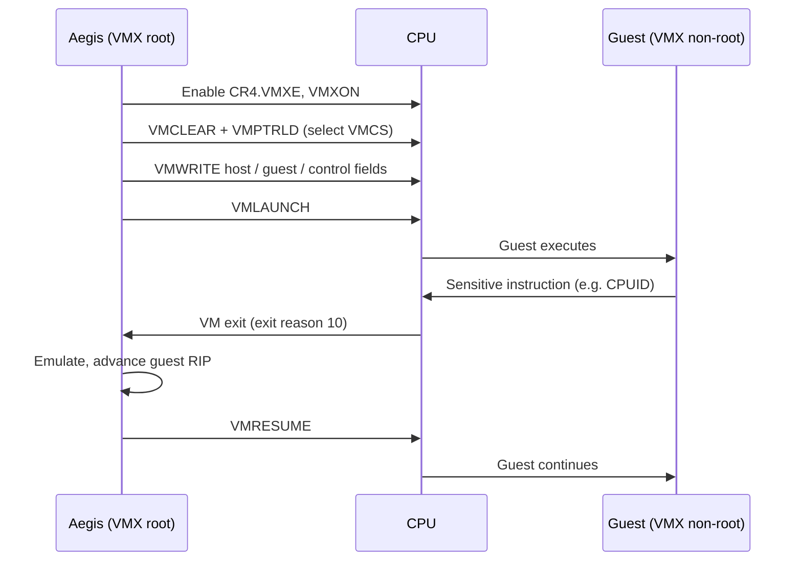

<div align="center">

# 🛡️ AEGIS

### The hypervisor layer of PyxisOS

A from-scratch x86_64 hypervisor built on hardware-assisted virtualization (Intel VT-x / AMD-V),
written to understand, and then own, the boundary between hardware and execution.


-b7410e?style=flat-square)

[](https://github.com/obstinix/PyxisOS)

[Status](#status) · [Architecture](#architecture) · [How it works](#how-hardware-virtualization-works) · [Roadmap](#roadmap) · [Dev setup](#development-environment) · [References](#references)

</div>

---

> [!WARNING]
> **Aegis has no working code yet.** This README documents the design and the plan.
> Anything marked *planned* is a goal, not a capability. Do not rely on Aegis to isolate anything.

## Status

| Area                         | State           |
| ---------------------------- | --------------- |
| Architecture & design docs   | 🟡 In progress  |
| Build system / toolchain     | ⚪ Not started  |
| VMX / SVM capability checks  | ⚪ Not started  |
| VMX operation (VMXON)        | ⚪ Not started  |
| First guest (VMLAUNCH)       | ⚪ Not started  |
| EPT / NPT memory isolation   | ⚪ Not started  |
| Lunar Core integration       | ⚪ Not started  |

This table is the source of truth. A row only changes when the matching code and test land in `main`.

## What Aegis is

Aegis is the virtualization component of **PyxisOS Track B**, the from-scratch kernel and hypervisor track.
It sits next to **Lunar Core** (the Rust kernel) and is responsible for one thing: running guest code
under hardware-enforced isolation, with every VM entry, VM exit, and memory mapping under explicit control.

It is not a wrapper around KVM, Xen, or Hyper-V. The point is to build each mechanism directly against
the processor manuals, so every layer is understood rather than inherited.

## Architecture

```text
┌──────────────────────────────────────────────────┐
│                PyxisOS (Track B)                 │
│        Lunar Core kernel · system services       │
├──────────────────────────────────────────────────┤
│              VM management interface             │
│        create · run · pause · destroy · IPC      │
├──────────────────────────────────────────────────┤
│                      AEGIS                       │
│  ┌───────────────────┐  ┌─────────────────────┐  │
│  │ vCPU + VMCS/VMCB  │  │  EPT / NPT memory   │  │
│  ├───────────────────┤  ├─────────────────────┤  │
│  │ VM-exit dispatch  │  │  Resource ownership │  │
│  └───────────────────┘  └─────────────────────┘  │
├──────────────────────────────────────────────────┤
│          Arch layer (VT-x  |  AMD-V/SVM)         │
├──────────────────────────────────────────────────┤
│       Hardware: CPU · RAM · interrupts · I/O     │
└──────────────────────────────────────────────────┘
```

*Target design. None of these layers exist in code yet.*

| Component          | Responsibility                                                                 |
| ------------------ | ------------------------------------------------------------------------------ |
| Arch layer         | Vendor-specific instructions (VMXON/VMLAUNCH vs VMRUN) behind one interface.   |
| vCPU               | Guest register state, control structures (VMCS on Intel, VMCB on AMD).         |
| VM-exit dispatch   | Decode exit reasons and route them to handlers (CPUID, HLT, I/O, EPT faults).  |
| EPT / NPT memory   | Second-level address translation: guest-physical → host-physical, per VM.      |
| Resource ownership | Track which VM owns which pages and vCPUs; guarantee clean teardown.           |
| Management API     | The narrow interface Lunar Core uses to create and control VMs.                |

## How hardware virtualization works

The core loop Aegis is built around, shown for Intel VT-x (AMD SVM follows the same shape with `VMRUN` and a VMCB):



Everything else (memory isolation, interrupts, devices) is built by deciding *which* events cause exits and *how* the host handles them.

## Design principles

- **Deny by default.** Guests get only the memory and exits Aegis explicitly configures.
- **Verify every state transition.** Check VMX instruction status flags (CF/ZF) and VM-entry failure codes on every call; never assume success.
- **Vendor code stays in the arch layer.** VT-x and SVM differences do not leak upward.
- **Small trusted core.** Keep the code that runs in VMX root mode minimal and auditable.
- **Honest status.** Docs describe what the code does, not what it will do.

## Open design decisions

These are unresolved and will be recorded as ADRs under `docs/architecture/` once decided.

| Decision                    | Options                                                          |
| --------------------------- | ---------------------------------------------------------------- |
| Hosting model               | Built into Lunar Core (kernel-hosted, KVM-style) vs. standalone bare-metal |
| First vendor target         | Intel VT-x first vs. AMD SVM first                                |
| Language split              | Rust `no_std` for logic, NASM for entry/exit stubs: exact boundary TBD |
| Guest memory strategy       | Identity-mapped EPT first vs. allocate-on-demand from the start  |
| First guest                 | Hand-written real-mode/long-mode stub vs. minimal existing kernel |

## Roadmap

Each phase has a concrete exit criterion. A box is ticked only when that criterion is demonstrated and the test is in the repo.

- [ ] **Phase 0 · Foundations**
  Repo layout, toolchain, CI, serial logging.
  *Done when:* a bootable image builds reproducibly and prints to serial under QEMU.

- [ ] **Phase 1 · Capability detection**
  Intel: `CPUID.1:ECX[5]` (VMX), `IA32_FEATURE_CONTROL` (MSR `0x3A`) lock/enable bits, `IA32_VMX_BASIC` (MSR `0x480`).
  AMD: `CPUID.8000_0001h:ECX[2]` (SVM), `VM_CR.SVMDIS` (MSR `0xC0010114`).
  *Done when:* Aegis reports support correctly on both a VMX-capable and a non-capable configuration.

- [ ] **Phase 2 · Enter VMX operation**
  Set `CR4.VMXE`, allocate the VMXON region with the correct revision ID, execute `VMXON` / `VMXOFF`.
  *Done when:* VMX root operation is entered and exited cleanly, with status checked and logged.

- [ ] **Phase 3 · First guest**
  Configure a VMCS and `VMLAUNCH` a tiny guest stub.
  *Done when:* the guest executes `CPUID` and `HLT`, and the host logs exit reasons 10 and 12 and resumes or stops it correctly.

- [ ] **Phase 4 · Memory virtualization**
  EPT page tables for guest-physical memory; handle EPT violations (exit reason 48).
  *Done when:* a guest access outside its mapped memory traps to Aegis instead of touching host memory.

- [ ] **Phase 5 · Lifecycle & resources**
  Create / run / pause / destroy; multiple VMs; virtual interrupt injection.
  *Done when:* VMs can be created and destroyed repeatedly with no leaked pages, verified by an ownership audit.

- [ ] **Phase 6 · Lunar Core integration**
  Management interface between the kernel and Aegis.
  *Done when:* Lunar Core starts and stops a guest through the API in an end-to-end test.

AMD SVM support follows the same phases once the arch layer is stable on the first vendor.

## Development environment

*Planned. Commands will be added once Phase 0 lands.*

| Tool                     | Purpose                                                            |
| ------------------------ | ------------------------------------------------------------------ |
| Rust (nightly, `no_std`) | Hypervisor logic                                                   |
| NASM                     | Entry points, VM-exit stubs, low-level glue                        |
| QEMU + KVM               | Fast testing; needs nested virtualization and `-cpu host` to expose VMX to the guest |
| Bochs (VMX-enabled build)| Slow but fully inspectable VMX emulation for debugging VMCS state  |
| GDB                      | Attach via QEMU `-s -S`                                            |

**WSL2 note:** testing a hypervisor inside QEMU requires nested virtualization to be enabled for the
WSL2 VM, and `/dev/kvm` to be available inside WSL. Without it, fall back to Bochs.

### Planned layout

```text
Aegis/
├── arch/
│   ├── vmx/          # Intel VT-x: VMXON, VMCS, exit handling
│   └── svm/          # AMD SVM: VMRUN, VMCB
├── core/             # vCPU, VM lifecycle, exit dispatch
├── mm/               # EPT / NPT, page ownership
├── guests/           # minimal test guests
├── tests/
└── docs/
    └── architecture/ # ADRs and design notes
```

## Contributing

Aegis is currently a solo learning-driven project, but issues and discussion are welcome.

1. Read the [status table](#status) and open design decisions first.
2. Use [Conventional Commits](https://www.conventionalcommits.org/) (`feat(vmx): …`, `fix(ept): …`, `docs: …`).
3. Every change that affects behavior needs a reproducible test or validation steps.
4. Cite the manual section (Intel SDM / AMD APM) for any architectural behavior you rely on.

## Non-goals and security

- Aegis is a research and learning hypervisor, **not** a production isolation boundary.
- No compatibility with existing VM image formats or management tools is planned.
- Security properties will be claimed only after they are implemented, tested, and documented.
  Until then, treat every guest as able to reach the host.

## References

- Intel® 64 and IA-32 Architectures Software Developer's Manual, **Volume 3C** (VMX chapters)
- AMD64 Architecture Programmer's Manual, **Volume 2**, Chapter 15: Secure Virtual Machine
- *Hypervisor From Scratch* tutorial series (Sina Karvandi)
- SimpleVisor (Alex Ionescu): a minimal VT-x hypervisor worth reading end to end
- Bochs source: a readable software implementation of VMX

## License

Licensed under the [Apache License 2.0](LICENSE), consistent with the rest of the PyxisOS ecosystem.

---

<div align="center">

**AEGIS** · *the boundary between hardware and execution*

Part of [PyxisOS](https://github.com/obstinix/PyxisOS) · built in the open by [obstinix](https://github.com/obstinix)

</div>
