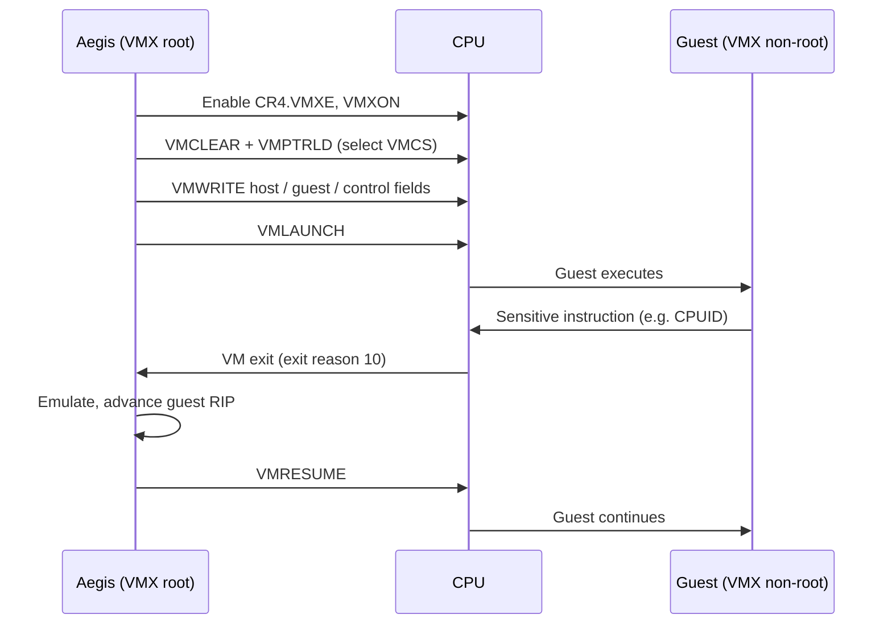

<div align="center">

# 🛡️ AEGIS

### The hypervisor layer of PyxisOS

A from-scratch x86_64 hypervisor built on hardware-assisted virtualization (Intel VT-x / AMD-V),
written to understand, and then own, the boundary between hardware and execution.


-b7410e?style=flat-square)

[](https://github.com/obstinix/PyxisOS)

[Status](#status) · [Architecture](#architecture) · [How it works](#how-hardware-virtualization-works) · [Roadmap](#roadmap) · [Dev setup](#development-environment) · [References](#references)

</div>

---

> [!WARNING]
> **Aegis is early, experimental code.** The hosted KVM backend boots Linux in tests under WSL2. It has not been tested on physical hardware or security-reviewed beyond this repository's own analysis, and the bare-metal core does no virtualization yet.
> Anything marked *planned* is a goal, not a capability. Do not rely on Aegis to isolate anything.

## Status

| Area                         | State           |
| ---------------------------- | --------------- |
| Architecture & design docs   | 🟡 In progress  |
| Build system / toolchain     | 🟢 Done (M0): Rust 1.97.0 pinned; fmt, clippy, tests, docs, `no_std`/UEFI builds and `cargo deny check` pass on Windows and WSL2. CI (`.github/workflows/ci.yml`) runs them on Linux and Windows, together with the reproducible-build check (`cargo xtask repro-test`) and the fuzz harnesses' smoke tests; its first run on GitHub passed on 2026-10-27 ([run 40412790382](https://github.com/obstinix/Aegis/actions/runs/40412790382)). Live KVM and nested tests stay local (ADR-0010). |
| `aegis-core` (lifecycle, memory map, exit model, backend interface, port + MMIO device bus, dispatch loop with a stop flag) | 🟡 Implemented; 41 tests on Windows and Linux, driven by a scripted mock backend. Used by the KVM backend; the bare-metal backend does not exist yet. |
| `aegis-devices` (16550 UART, transmit-only; virtio-mmio transport, split virtqueue, virtio-console output and input) | 🟡 Implemented, `no_std`; 38 tests (mock memory and interrupt line), and driven by real KVM guests and Linux boots. Console output goes to a pluggable sink: a capped buffer by default, `aegis run`'s stream in practice. Console input reaches the guest once it has written to `/dev/hvc0` (see the roadmap's M6h limits). The virtqueue and virtio-mmio paths have fuzz harnesses ([`docs/fuzzing.md`](docs/fuzzing.md)). |
| `aegis doctor` capability report | 🟢 Done (M1): tested live and with fixtures on Windows and WSL2, including KVM API version and extension queries. |
| Hosted KVM backend (stage 1) | 🟡 M3, M4h and M6h done: `aegis run --config vm.toml` boots a Linux bzImage + initramfs to `/init` under KVM, with in-kernel irqchip/PIT, a UART console and a seccomp allowlist. With `vcpus = 2..8` the vCPUs are described in ACPI (MADT) and each runs on its own sandboxed thread; `virtio_console = true` adds a virtio-console over virtio-mmio, declared in the ACPI DSDT. `virtio_console_stdin = true` forwards `aegis run`'s stdin to the guest's `/dev/hvc0` (M6h). Guest console output is streamed to stdout while the guest runs: UART output as it is, hvc0 lines prefixed `hvc0| `. It is not an interactive console yet: there is no terminal raw mode and no Ctrl-C passthrough. Tested live in WSL2 with 1, 2, 4 and 8 vCPUs. Not yet tested on physical hardware: the M5h script and checklist are ready ([`docs/hardware-validation.md`](docs/hardware-validation.md)) but have not been run on the ThinkPad. |
| Bare-metal UEFI core (`aegis-uefi`) and nested test harness | 🟡 B0 done: `cargo xtask uefi-test` boots the UEFI application under QEMU/KVM with OVMF, nested in WSL2. It passes when the app's serial marker appears and the VM powers itself off. The app does no virtualization yet. |
| VMX / SVM capability checks  | ⚪ Not started  |
| VMX operation (VMXON)        | ⚪ Not started  |
| First guest (VMLAUNCH)       | ⚪ Not started  |
| EPT / NPT memory isolation   | ⚪ Not started  |
| Lunar Core integration       | ⚪ Not started  |

This table is the source of truth. A row only changes when the matching code and test land in `main`.

## What Aegis is

Aegis is the virtualization component of **PyxisOS Track B**, the from-scratch kernel and hypervisor track.
It sits next to **Lunar Core** (the Rust kernel) and is responsible for one thing: running guest code
under hardware-enforced isolation, with every VM entry, VM exit, and memory mapping under explicit control.

Aegis is built in two stages ([ADR-0001](research/architecture-decision-record.md#adr-0001-staged-architecture)):

1. **Hosted:** a Linux KVM backend, built on the rust-vmm crates, so Aegis can run, test and manage real VMs early.
2. **Bare metal:** a from-scratch VMX core, written directly against the processor manuals so every layer is
   understood rather than inherited. It runs as a UEFI application and is developed alongside the hosted stage.

Both stages sit behind the same vCPU, guest-memory and exit-dispatch interfaces. The bare-metal core is
not a wrapper around KVM, Xen, or Hyper-V.

## Architecture

```text
┌──────────────────────────────────────────────────┐
│                PyxisOS (Track B)                 │
│        Lunar Core kernel · system services       │
├──────────────────────────────────────────────────┤
│              VM management interface             │
│        create · run · pause · destroy · IPC      │
├──────────────────────────────────────────────────┤
│                      AEGIS                       │
│  ┌───────────────────┐  ┌─────────────────────┐  │
│  │ vCPU + VMCS/VMCB  │  │  EPT / NPT memory   │  │
│  ├───────────────────┤  ├─────────────────────┤  │
│  │ VM-exit dispatch  │  │  Resource ownership │  │
│  └───────────────────┘  └─────────────────────┘  │
├──────────────────────────────────────────────────┤
│          Arch layer (VT-x  |  AMD-V/SVM)         │
├──────────────────────────────────────────────────┤
│       Hardware: CPU · RAM · interrupts · I/O     │
└──────────────────────────────────────────────────┘
```

*Target design. None of these layers exist in code yet.*

| Component          | Responsibility                                                                 |
| ------------------ | ------------------------------------------------------------------------------ |
| Arch layer         | Vendor-specific instructions (VMXON/VMLAUNCH vs VMRUN) behind one interface.   |
| vCPU               | Guest register state, control structures (VMCS on Intel, VMCB on AMD).         |
| VM-exit dispatch   | Decode exit reasons and route them to handlers (CPUID, HLT, I/O, EPT faults).  |
| EPT / NPT memory   | Second-level address translation: guest-physical → host-physical, per VM.      |
| Resource ownership | Track which VM owns which pages and vCPUs; guarantee clean teardown.           |
| Management API     | The narrow interface Lunar Core uses to create and control VMs.                |

## How hardware virtualization works

The core loop Aegis is built around, shown for Intel VT-x (AMD SVM follows the same shape with `VMRUN` and a VMCB):



Everything else (memory isolation, interrupts, devices) is built by deciding *which* events cause exits and *how* the host handles them.

## Design principles

- **Deny by default.** Guests get only the memory and exits Aegis explicitly configures.
- **Verify every state transition.** Check VMX instruction status flags (CF/ZF) and VM-entry failure codes on every call; never assume success.
- **Vendor code stays in the arch layer.** VT-x and SVM differences do not leak upward.
- **Small trusted core.** Keep the code that runs in VMX root mode minimal and auditable.
- **Honest status.** Docs describe what the code does, not what it will do.

## Design decisions

Recorded in [`research/architecture-decision-record.md`](research/architecture-decision-record.md). Research behind them is in [`research/`](research/).

| Decision                    | Outcome                                                          |
| --------------------------- | ---------------------------------------------------------------- |
| Hosting model               | Staged: hosted KVM first, standalone bare-metal UEFI core in parallel (ADR-0001) |
| First vendor target         | Intel VT-x first; AMD SVM after (ADR-0005)                        |
| Language split              | Rust stable everywhere, with inline `asm!` for VMX; NASM only for test guests (ADR-0002) |
| Guest memory strategy       | Explicit guest memory map; EPT built only from it, never identity-mapping host RAM (ADR-0006) |
| First guest                 | Hand-written real-mode stub, then a Linux bzImage (ADR-0008, roadmap M2/M3) |
| License                     | Apache-2.0 (ADR-0011, *proposed*: `LICENSE` file not yet added)  |

## Roadmap

Each phase has a concrete exit criterion. A box is ticked only when that criterion is demonstrated and the test is in the repo.

The detailed milestone plan, including the hosted KVM track that comes first, is in
[`research/development-roadmap.md`](research/development-roadmap.md). The phases below describe the bare-metal track.

- [x] **Phase 0 · Foundations**
  Repo layout, toolchain, CI, serial logging.
  *Done when:* a bootable image builds reproducibly and prints to serial under QEMU.
  *Status:* done 2026-10-27.
  - The image boots and prints under QEMU, tested by `cargo xtask uefi-test` (roadmap B0). This test runs locally only, nested under KVM in WSL2, not in CI.
  - It builds reproducibly, tested by `cargo xtask repro-test`: two clean builds must be byte-identical. That holds per host; Windows and Linux builds differ from each other.
  - CI (`.github/workflows/ci.yml`) runs the checks and `repro-test` on Linux and Windows. Its first run on GitHub passed ([run 40412790382](https://github.com/obstinix/Aegis/actions/runs/40412790382)).

- [ ] **Phase 1 · Capability detection**
  Intel: `CPUID.1:ECX[5]` (VMX), `IA32_FEATURE_CONTROL` (MSR `0x3A`) lock/enable bits, `IA32_VMX_BASIC` (MSR `0x480`).
  AMD: `CPUID.8000_0001h:ECX[2]` (SVM), `VM_CR.SVMDIS` (MSR `0xC0010114`).
  *Done when:* Aegis reports support correctly on both a VMX-capable and a non-capable configuration.

- [ ] **Phase 2 · Enter VMX operation**
  Set `CR4.VMXE`, allocate the VMXON region with the correct revision ID, execute `VMXON` / `VMXOFF`.
  *Done when:* VMX root operation is entered and exited cleanly, with status checked and logged.

- [ ] **Phase 3 · First guest**
  Configure a VMCS and `VMLAUNCH` a tiny guest stub.
  *Done when:* the guest executes `CPUID` and `HLT`, and the host logs exit reasons 10 and 12 and resumes or stops it correctly.

- [ ] **Phase 4 · Memory virtualization**
  EPT page tables for guest-physical memory; handle EPT violations (exit reason 48).
  *Done when:* a guest access outside its mapped memory traps to Aegis instead of touching host memory.

- [ ] **Phase 5 · Lifecycle & resources**
  Create / run / pause / destroy; multiple VMs; virtual interrupt injection.
  *Done when:* VMs can be created and destroyed repeatedly with no leaked pages, verified by an ownership audit.

- [ ] **Phase 6 · Lunar Core integration**
  Management interface between the kernel and Aegis.
  *Done when:* Lunar Core starts and stops a guest through the API in an end-to-end test.

AMD SVM support follows the same phases once the arch layer is stable on the first vendor.

## Development environment

Common commands, from the repository root:

```text
cargo test --workspace                          # unit and mock tests (any host)
cargo test --workspace -- --include-ignored     # plus live KVM tests (Linux with /dev/kvm)
cargo xtask uefi-test                           # boot aegis-uefi under QEMU/KVM + OVMF (Linux; here, WSL2)
cargo run -p aegis-cli -- doctor                # what this host can run
cargo run -p aegis-cli -- run --config vm.toml  # boot a Linux guest under KVM (Linux)
```

| Tool                     | Purpose                                                            |
| ------------------------ | ------------------------------------------------------------------ |
| Rust (stable, pinned)    | All Aegis code; `no_std` for the core and the bare-metal track     |
| NASM                     | Tiny test-guest images                                             |
| QEMU + KVM               | Fast testing; needs nested virtualization and `-cpu host` to expose VMX to the guest |
| Bochs (VMX-enabled build)| Slow but fully inspectable VMX emulation for debugging VMCS state  |
| GDB                      | Attach via QEMU `-s -S`                                            |

**WSL2 note:** testing a hypervisor inside QEMU requires nested virtualization to be enabled for the
WSL2 VM, and `/dev/kvm` to be available inside WSL. Your WSL user must also be in the `kvm` group:
`/dev/kvm` is `root:kvm 660`. Without it, fall back to Bochs.

### Layout

From [ADR-0003](research/architecture-decision-record.md#adr-0003-workspace-layout-and-crate-boundaries); all of these exist now:

```text
Aegis/
├── crates/
│   ├── aegis-core/     # no_std: VM config, lifecycle, exit model, guest memory map
│   ├── aegis-probe/    # capability detection (CPUID, /dev/kvm, nested params)
│   ├── aegis-kvm/      # hosted backend (Linux KVM, rust-vmm)
│   ├── aegis-uefi/     # bare-metal VMX core (UEFI application)
│   ├── aegis-devices/  # backend-neutral device models (16550 UART first)
│   └── aegis-cli/      # `aegis` binary: doctor, run, version
├── xtask/              # build and QEMU test orchestration
├── tests/guests/       # NASM test-guest sources
├── research/           # research reports and ADRs
└── docs/
```

## Contributing

Aegis is currently a solo learning-driven project, but issues and discussion are welcome.

1. Read the [status table](#status) and open design decisions first.
2. Use [Conventional Commits](https://www.conventionalcommits.org/) (`feat(vmx): …`, `fix(ept): …`, `docs: …`).
3. Every change that affects behavior needs a reproducible test or validation steps.
4. Cite the manual section (Intel SDM / AMD APM) for any architectural behavior you rely on.

## Non-goals and security

- Aegis is a research and learning hypervisor, **not** a production isolation boundary.
- No compatibility with existing VM image formats or management tools is planned.
- Security properties will be claimed only after they are implemented, tested, and documented.
  Until then, treat every guest as able to reach the host.

## References

- Intel® 64 and IA-32 Architectures Software Developer's Manual, **Volume 3C** (VMX chapters)
- AMD64 Architecture Programmer's Manual, **Volume 2**, Chapter 15: Secure Virtual Machine
- *Hypervisor From Scratch* tutorial series (Sina Karvandi)
- SimpleVisor (Alex Ionescu): a minimal VT-x hypervisor worth reading end to end
- Bochs source: a readable software implementation of VMX

## License

Licensed under the [Apache License 2.0](LICENSE), consistent with the rest of the PyxisOS ecosystem.

---

<div align="center">

**AEGIS** · *the boundary between hardware and execution*

Part of [PyxisOS](https://github.com/obstinix/PyxisOS) · built in the open by [obstinix](https://github.com/obstinix)

</div>
