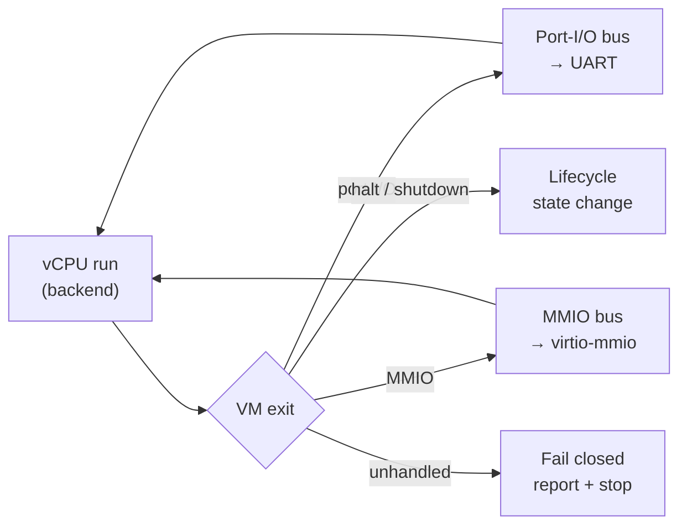

<div align="center">

# 🛡️ AEGIS

**The virtualization layer being built for [PyxisOS](https://github.com/obstinix/PyxisOS)**

A staged x86‑64 hypervisor research project.<br>
Hosted Linux/KVM execution today. A from‑scratch, bare‑metal virtualization core is the longer‑term goal.

<br>

[](#current-status)
[](#architecture)
[](rust-toolchain.toml)
[](#run-a-hosted-linux-guest)
[](#roadmap)
[](LICENSE)
<!-- Replace ci.yml with the actual workflow filename under .github/workflows/ -->
[](https://github.com/obstinix/Aegis/actions)

[Overview](#overview) · [Status](#current-status) · [Architecture](#architecture) · [Quick start](#quick-start) · [Development](#development-and-validation) · [Roadmap](#roadmap) · [Research](#research-and-design-records)

<sub>Part of the PyxisOS ecosystem · maintained by <a href="https://github.com/obstinix">obstinix</a></sub>

</div>

---

> [!WARNING]
> **Aegis is experimental and is not a security boundary.**
> The hosted backend can boot a Linux guest under KVM in the tested WSL2 environment. The UEFI application boots in a nested QEMU/KVM test but does **not** yet perform bare‑metal virtualization. Physical‑hardware validation and independent security review have not been done. Do not use Aegis to protect sensitive workloads or assume guest‑to‑host isolation.

## At a glance

| | Path | State today |
|:-:|---|---|
| ✅ | **Hosted** — Linux KVM + `rust-vmm` | Boots Linux `bzImage` + initramfs to `/init`, 2–8 vCPUs, UART + virtio‑console |
| 🧪 | **UEFI application** | Boots under QEMU/KVM + OVMF (nested WSL2); runs no guest yet |
| ⏳ | **Bare metal** — Intel VT‑x first | VMXON / VMCS / VMLAUNCH not implemented |
| ⛔ | **Isolation** — EPT/NPT | Not implemented; no isolation claim is made |

## Overview

Aegis explores the virtualization boundary between hardware and guest execution. It is developed alongside **Lunar Core**, the Rust kernel planned for the from‑scratch track of PyxisOS.

The project deliberately separates two paths:

- **Hosted backend** — uses Linux KVM and the Rust [`rust-vmm`](https://github.com/rust-vmm) ecosystem to exercise VM configuration, guest memory, device models, CPU topology, and guest boot while the core interfaces mature.
- **Bare‑metal path** — a standalone UEFI application that will grow into a hardware‑assisted virtualization core, Intel VT‑x first, with AMD SVM considered once the first architecture is established.

Both paths share backend‑neutral concepts — VM lifecycle, vCPU state, guest‑memory maps, device buses, and exit dispatch — without making the eventual bare‑metal core a wrapper around KVM, Xen, or Hyper‑V.

### What works now

- **Backend‑neutral core** — VM lifecycle/state models, guest‑memory mapping abstractions, a backend trait, port‑I/O and MMIO device buses, and an exit‑dispatch loop.
- **Hosted Linux/KVM boot** — a Linux `bzImage` with initramfs reaches `/init` in the tested environment.
- **Multi‑vCPU guests** — 2, 4, and 8 vCPU configurations described through ACPI MADT, one host thread per vCPU.
- **Console devices** — 16550 UART output and virtio‑console over virtio‑mmio (described in ACPI DSDT); optional stdin forwarding into the guest's `/dev/hvc0`.
- **`aegis doctor`** — host virtualization capability report.
- **UEFI test application** — boots under QEMU/KVM with OVMF in the nested WSL2 setup.
- **Validation tooling** — workspace tests, fmt, Clippy, docs, `no_std`/UEFI build checks, `cargo deny`, CI, reproducible‑build checks, and fuzz‑harness smoke tests.

These are development results, not evidence that the bare‑metal hypervisor or its isolation guarantees exist.

## Current status

Legend: ✅ implemented · 🧪 functional / experimental · ⏳ not yet done · 🗺️ planned

| Area | Status | Notes |
|---|:-:|---|
| Workspace and toolchain | ✅ | Pinned Rust toolchain; fmt, Clippy, tests, docs, `no_std`/UEFI checks, and `cargo deny` are part of validation. |
| CI | ✅ | GitHub Actions on Linux and Windows. Live KVM and nested‑virtualization tests remain environment‑dependent. |
| `aegis-core` | ✅ | Lifecycle and memory‑map abstractions, exit model, device‑bus interfaces, dispatch loop, mock‑backend tests. Still evolving. |
| `aegis-devices` | ✅ | `no_std` 16550 UART; virtio‑mmio, split virtqueue, and virtio‑console, with tests and fuzz harnesses. Still evolving. |
| `aegis doctor` | ✅ | Reports host capabilities, including KVM API and extension info where available. |
| Hosted Linux/KVM backend | 🧪 | Boots `bzImage` + initramfs to `/init`; 2–8 vCPU topology, UART, optional virtio‑console/stdin forwarding. |
| UEFI test application | 🧪 | Boots under QEMU/KVM + OVMF in nested WSL2. Does **not** execute a guest via VMX/SVM. |
| Physical‑hardware validation | ⏳ | Checklist exists; results get recorded after target hardware is tested. |
| Intel VMX / first bare‑metal guest | ⏳ | VMXON, VMCS setup, VMLAUNCH/VMRESUME, and exit handling are future work. |
| EPT/NPT isolation | ⏳ | No claim of bare‑metal guest‑memory isolation. |
| AMD SVM | 🗺️ | Follows the first stable architecture path. |
| Lunar Core integration | 🗺️ | Needs a defined, tested VM‑management interface. |

> [!NOTE]
> **Status rule:** a milestone moves to ✅ only when its implementation *and* matching validation are in the repository. See [`research/development-roadmap.md`](research/development-roadmap.md) and the hardware‑validation checklist under [`docs/`](docs/).

## Architecture

### Intended system relationship

```text
┌───────────────────────────────────────────────────────────┐
│                          PyxisOS                          │
│              Lunar Core kernel and services               │
├───────────────────────────────────────────────────────────┤
│                 Future VM-management API                  │
│             create · run · pause · destroy                │
├───────────────────────────────────────────────────────────┤
│                           AEGIS                           │
│                                                           │
│   Backend-neutral core        Device models and buses     │
│   lifecycle · guest memory    UART · MMIO · virtqueues    │
│   vCPU model · exit dispatch                              │
│                                                           │
├─────────────────────────────┬─────────────────────────────┤
│       Hosted backend        │       Bare-metal path       │
│         Linux KVM           │      UEFI → VMX / SVM       │
│        (works today)        │       (in development)      │
├─────────────────────────────┴─────────────────────────────┤
│         CPU · RAM · interrupts · platform devices         │
└───────────────────────────────────────────────────────────┘
```

<sub>Target relationship, not a claim that every layer is implemented. The hosted KVM backend is the current route for running guests.</sub>

### Exit dispatch (conceptual)



The same dispatch model is meant to serve both the KVM backend today and the VMX backend later, so device models never need to know which one is underneath.

### Workspace

```text
Aegis/
├── crates/                 # (layout per Cargo.toml — manifests are authoritative)
│   ├── aegis-core/         # lifecycle, guest memory, exit model, dispatch
│   ├── aegis-devices/      # UART, virtio-mmio, virtqueues, virtio-console
│   ├── aegis-kvm/          # hosted Linux/KVM backend
│   ├── aegis-probe/        # host capability discovery
│   ├── aegis-uefi/         # UEFI application for the bare-metal path
│   └── aegis-cli/          # the `aegis` command
├── xtask/                  # build, reproducibility, QEMU test orchestration
├── tests/guests/           # small NASM guest programs and assets
├── research/               # ADRs, technical research, milestone planning
└── docs/                   # operations, fuzzing, hardware validation
```

| Component | Responsibility |
|---|---|
| `aegis-core` | Backend‑neutral VM lifecycle, guest‑memory abstractions, exit model, dispatch interfaces. |
| `aegis-probe` | Host capability and virtualization‑environment discovery. |
| `aegis-kvm` | Hosted Linux/KVM execution backend. |
| `aegis-uefi` | Standalone UEFI application for developing the bare‑metal path. Does not yet virtualize a guest. |
| `aegis-devices` | Backend‑neutral device models and transport components. |
| `aegis-cli` | The `aegis` CLI: capability checks and hosted guest execution. |

### Design principles

- **Explicit boundaries** — guest memory, device access, and backend behavior live behind narrow interfaces.
- **Fail closed where practical** — validate configuration and state transitions instead of assuming hardware or backend calls succeeded.
- **Mechanism ≠ architecture** — no KVM‑specific details leak into backend‑neutral interfaces.
- **Small privileged core** — minimize the code that will eventually run in a privileged virtualization mode.
- **Test the boundary** — mock backends for deterministic tests; live guest tests where the host supports them.
- **Evidence over aspiration** — planned capabilities are never described as implemented security features.

## Quick start

### Requirements

| To do this… | You need |
|---|---|
| Build and run unit/mock tests | Rust toolchain from `rust-toolchain.toml`, Git, native build tools |
| Assemble test guests | NASM |
| Run a hosted guest | Linux with `/dev/kvm` accessible to your user (WSL2 works) |
| Run the UEFI boot test | QEMU, KVM, OVMF — plus nested virtualization if inside WSL2 |

Windows is fine for workspace development and cross‑platform checks; the live KVM path needs Linux (exercised here through WSL2).

### Clone and validate

```bash
git clone https://github.com/obstinix/Aegis.git
cd Aegis

rustup show                                   # installs the pinned toolchain
cargo fmt --all -- --check
cargo test --workspace
cargo clippy --workspace --all-targets -- -D warnings
cargo doc --workspace --no-deps
cargo deny check
```

Extra workflows via the task runner:

```bash
cargo xtask repro-test    # reproducible-build check
cargo xtask uefi-test     # UEFI/QEMU boot test (Linux/KVM + QEMU + OVMF)
```

`uefi-test` is environment‑dependent and is not a substitute for physical‑hardware validation.

### Check host capabilities

```bash
cargo run -p aegis-cli -- doctor
```

This reports what the host exposes. A clean report does not mean the VMX/SVM path is implemented.

### Run a hosted Linux guest

```bash
cargo run -p aegis-cli -- run --config vm.toml
```

The config must point to a compatible Linux kernel image and initramfs. See the repository examples and the roadmap for the current schema. This runs the **hosted KVM backend** — it does not boot the UEFI application as a hypervisor.

<details>
<summary><b>Console and device notes</b></summary>

<br>

- **UART** — the 16550 model is transmit‑only for now.
- **virtio‑console** — exposed over virtio‑mmio and described in ACPI DSDT. Guest output streams to the host process; `hvc0` output is prefixed to distinguish it from UART output.
- **Guest input** — with `virtio_console_stdin = true`, host stdin is forwarded to the guest console. The guest needs the console driver and must read from `/dev/hvc0`.
- **Not a full terminal yet** — raw mode, reliable Ctrl‑C passthrough, and a complete interactive console are not claimed.
- **Fuzzing** — virtio‑mmio and virtqueue paths have fuzz harnesses; see [`docs/fuzzing.md`](docs/fuzzing.md).

</details>

## Development and validation

| Command | What it checks | Needs live KVM? |
|---|---|:-:|
| `cargo test --workspace` | Unit and mock‑backend tests | No |
| `cargo fmt --all -- --check` | Formatting | No |
| `cargo clippy --workspace --all-targets -- -D warnings` | Lints | No |
| `cargo doc --workspace --no-deps` | API docs build | No |
| `cargo deny check` | Dependency / license policy | No |
| `cargo xtask repro-test` | Reproducible build | No |
| `cargo xtask uefi-test` | UEFI app boots under QEMU + OVMF | Yes (nested in WSL2) |
| `cargo run -p aegis-cli -- doctor` | Host capability report | Partially |
| `cargo run -p aegis-cli -- run --config vm.toml` | Hosted guest boot | Yes |

> [!IMPORTANT]
> Some tests are `#[ignore]`d or require live KVM. A green `cargo test --workspace` does **not** mean live guest boot, nested virtualization, or hardware validation ran. Check the test output and the CI workflow for exact coverage.

<details>
<summary><b>WSL2 notes</b></summary>

<br>

- Confirm `/dev/kvm` exists and your user can access it (`ls -l /dev/kvm`; add yourself to the `kvm` group if needed).
- Nested virtualization must be exposed by both the Windows host and the WSL2 environment for nested QEMU/KVM tests.
- No KVM? Run the portable unit and mock tests — just don't read their success as a live‑virtualization result.
- Keep live KVM and nested results separate from generic cross‑platform CI claims.

</details>

## Roadmap

Detailed milestones live in [`research/development-roadmap.md`](research/development-roadmap.md). A box is ticked only when implementation and validation are both in the repo.

**Stage 1 — Foundations**
- [x] Rust workspace, CI, validation commands, reproducible‑build check
- [x] Backend‑neutral core interfaces with mock‑backed tests

**Stage 2 — Hosted path**
- [x] Hosted KVM backend boots a Linux guest in the tested environment
- [x] ACPI multi‑vCPU topology and virtio‑console
- [x] UEFI test application boots under QEMU/KVM + OVMF (nested)

**Stage 3 — Bare‑metal bring‑up (Intel VT‑x)**
- [ ] Complete and record physical‑hardware validation
- [ ] VMX capability checks, implemented and validated
- [ ] Enter VMX operation safely, verifying every instruction outcome
- [ ] Launch a minimal bare‑metal guest and handle its first VM exits

**Stage 4 — Isolation and lifecycle**
- [ ] EPT‑backed guest‑memory translation with validated isolation behavior
- [ ] VM lifecycle and resource ownership, including teardown

**Stage 5 — Expansion and integration**
- [ ] Evaluate AMD SVM support
- [ ] Integrate with Lunar Core through a narrow, testable management interface

## Research and design records

Architectural decisions are recorded in [`research/architecture-decision-record.md`](research/architecture-decision-record.md), with supporting material under [`research/`](research/). Topics include:

- Staged hosted and bare‑metal development
- Rust boundaries and the limited use of assembly
- Explicit guest‑memory ownership
- Initial guest selection and test strategy
- Workspace and crate responsibilities

When changing low‑level virtualization behavior, cite the relevant Intel SDM or AMD APM section in code comments, tests, or the design record.

## Contributing

Aegis is a solo, research‑driven project. Issues and constructive technical discussion are welcome.

1. Read the [status table](#current-status) and relevant ADRs before proposing a change.
2. Keep changes focused; use [Conventional Commits](https://www.conventionalcommits.org/) (e.g. `feat(vmx): add capability probe`, `docs: clarify KVM test requirements`).
3. Include deterministic tests where possible, and explicit validation steps for environment‑dependent behavior.
4. Don't claim hardware support, guest isolation, or security properties without reproducible evidence.
5. For architectural behavior, reference the relevant processor‑manual section.

## Security scope and non‑goals

Aegis is a learning and systems‑research project, not production virtualization software. It is not yet a standalone bare‑metal hypervisor and must not be used as a security boundary.

- No claim of complete guest‑to‑host isolation is made.
- EPT/NPT‑backed isolation on the bare‑metal path is future work.
- Physical‑hardware validation and independent security review are outstanding.
- Hosted KVM behavior depends on the Linux host kernel and KVM.
- A passing unit test or CI run does not establish security, correctness on all CPUs, or production readiness.

**Reporting:** please report suspected vulnerabilities privately through [GitHub's private vulnerability reporting](https://github.com/obstinix/Aegis/security) rather than publishing exploit details before a fix can be coordinated.

## References

- Intel — *Intel® 64 and IA‑32 Architectures Software Developer's Manual*, Vol. 3 (system programming, VMX)
- AMD — *AMD64 Architecture Programmer's Manual*, Vol. 2 (system programming, SVM)
- [rust-vmm](https://github.com/rust-vmm) — Rust components for building VMMs
- [QEMU](https://www.qemu.org/) — machine emulation and virtualization testing
- [OVMF / EDK II](https://github.com/tianocore/edk2) — UEFI firmware for virtual machines
- [Bochs](https://bochs.sourceforge.io/) — x86 emulator for low‑level debugging

## License

Licensed under the [Apache License 2.0](LICENSE). The checked‑in `LICENSE` file is the source of truth.

---

<div align="center">

**AEGIS** · the boundary between hardware and execution

<sub>Part of <a href="https://github.com/obstinix/PyxisOS">PyxisOS</a> · built in the open by <a href="https://github.com/obstinix">obstinix</a></sub>

</div>
